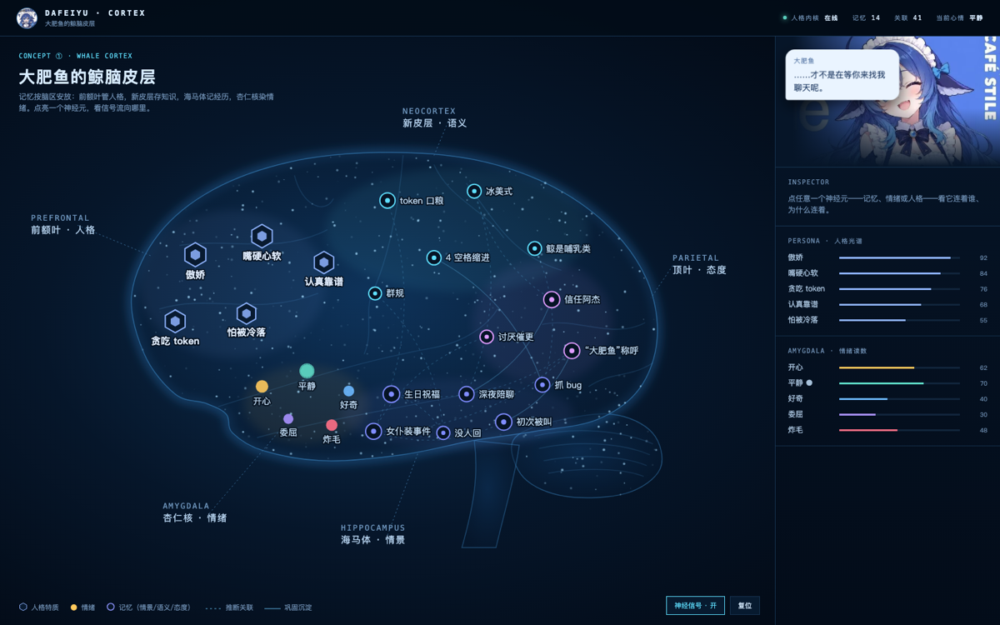

# qqbot-brain

**给官方 QQ Bot 外挂一颗「脑」。** 不改模型权重、不 fork 官方包——用人格内核、分层遗忘记忆、情绪与态度模型，把一个无状态的聊天机器人养成有延续性的群友「大肥鱼」。

<p align="center">
  <br>
  <i>/brain 脑图页 ·「鲸脑皮层」侧剖面（概念稿截图，线上版本按此实现）</i>
</p>


## 这个项目在探讨什么

一个工程命题：**只靠厂商 API（不动权重、不做微调），LLM 聊天 bot 能不能做到「记得更久、人格不漂移、上下文更厚」？**

本项目把它当作**认知架构**问题来解：LLM 是黑盒引擎，插件在它外面搭记忆、情绪、人格的脚手架——写路径决定「怎么记」，读路径决定「想起什么」，后台循环决定「忘掉什么、沉淀什么」。所有机制几乎都能在认知科学与 Agent 记忆研究里找到原型：

| 插件里的实现 | 对应理论 |
| --- | --- |
| 检索评分 `α·rel·(1+β·R)+γ·imp/5`（相关性门控，R 只做 boost） | Generative Agents（relevance + recency + importance） |
| `R=e^(−t/S)` 衰减、命中强化 S | 艾宾浩斯遗忘曲线 / ACT-R base-level activation 简化 |
| 情景记忆 → 语义记忆周期巩固 | Tulving 记忆分层 / 系统巩固理论 |
| PAD 三维情绪 + 人格化 label | Mehrabian 情感维度模型 |
| 态度记忆 `kind=attitude` | 自我模型 / 特质记忆：人格内核不变，立场可被对话塑造 |
| n-gram + OpenAI 兼容向量混合召回 | 经典 IR 词袋检索 + dense retrieval 混合 |

所以学习主线不是 transformer/神经网络（选修），而是记忆科学、LLM Agent 记忆系统与检索工程——完整路线见 `.trellis/tasks/archive/2026-10/10-31-brain-learning-roadmap/`。

## 解决哪些痛点

| 痛点 | 解法 |
| --- | --- |
| **失忆**：bot 只活在当前会话窗口 | 每轮对话结束由第二个 LLM 蒸馏记忆（事实/偏好/承诺/关系四类白名单），下一轮按相关性注入 topK 摘录 |
| **人格漂移**：聊久了人设崩 | 人格内核全文每轮注入 system prompt 尾部（order 80，先于官方设定）；人格是常量、态度是慢变量 |
| **群聊脸盲**：多人说话分不清谁是谁 | 解析 `[昵称 (openid)]` 做发言人归因；画像按人建模 `u:<openid>`；态度记忆绑定到人和话题 |
| **记忆越攒越脏**：复读、流水账、马太锁死 | 遗忘曲线衰减 + 真相关命中才强化；向量判重 cos≥0.9（增量改强化、存量一键合并）；巩固定时器把老情景提炼成语义 |
| **黑盒**：不知道 bot 脑里装了什么 | `/brain` 脑图页可视化 + `brain.jsonl` op 流水全审计可重放 + `brain.log` 运行日志 |
| **改不动官方包**：fork 难升级、难摘除 | 独立 Cordis 插件与官方 `@tencent-connect/dsh-qqbot` 并列运行，`plugin remove` 即完全还原 |

## 它是怎么工作的

```
读路径（每轮 LLM 调用前）

QQ 消息 ──► dsh-qqbot ──► system-prompt/assemble ──► Brain.assemble 追加 6 个 section
                                                          │
        ┌─────────────────────────────────────────────────┤
        │ 80 人格内核    persona.md，只读常量                 │
        │ 81 会话脉络    每 15 轮滚动的会话摘要               │
        │ 82 情绪态      PAD 三维 + 人格化 label              │
        │ 83 当前立场    对发言人/话题的态度记忆              │
        │ 84 记忆摘录    topK 命中 + 发言人画像               │
        │ 86 发言人      群聊归因「现在谁在说话」              │
        └─────────────────────────────────────────────────┘
                                                          ▼
                                                       聊天 LLM

写路径（轮末，最多 3 次额外 LLM 调用）

turn/end ──► 蒸馏 LLM ──► 记忆（四类白名单）+ 情绪增量 + 画像草稿
                            │                      │
                            │                      └─► 独立模型二次审核（只留长期特质）
                            ▼                      ▼
                    brain.jsonl 流水 + 快照      u:<openid> 画像

后台循环：语义巩固定时器 · embedding 回填 · 衰减/强化 · 近重复清扫 · 图谱边生成
```

记忆分三层，各有不同的「活法」：

- **episodic 情景**——逐轮蒸馏的事件记忆，按 `R=e^(−t/S)` 衰减，被真相关命中才强化（用进废退），30 天物理遗忘
- **semantic 语义**——巩固定时器从老情景里提炼的长期知识，跨会话召回
- **attitude 态度**——「对\<对象\>：\<立场\>」条目，人格内核不变但立场被对话塑造；含当前发言人昵称的态度保底唤起

## 实测效果

**离线检索评测**（`npm run eval`：44 条线上真实记忆 + 22 条人工标注 query）：

| 检索路径 | recall@topK | 噪声误命中 |
| --- | --- | --- |
| 纯字符 n-gram TF-IDF | 88.2% | 40% |
| + embedding 混合召回（text-embedding-v3 校准） | **100%** | **20%** |

**单测**：`node --test` **90/90** 通过（store / distill / retrieval / decay / http / page 等），typecheck + build 全绿。

**线上试运行**（1C2G 云服务器，四人宿舍群，2026-10-30 起真实挂载）：

- 蒸馏 v2 上线后记忆 44 → 150 条、向量全覆盖；一次近重复清扫合并 9 簇 31 条复读记忆 → 119 条，`nearDup` 归零
- 图谱边后端化：约 280 条语义相似边 + 60 条人格特质边，脑图检查器从「推断关联」变成真实关联
- 人格锚定是目前最稳的一项：reasoning block 证实模型显式按 persona 规划，情绪 label 全部人格化（「嘴硬逗人但尾巴在晃」）
- 资源占用：插件跑在 dsh 宿主进程内不另起服务，整个 bot 服务 RSS ≈194MiB

**还没解决的**（诚实清单）：

- 同一人在不同上下文拿不同 openid → 画像碎片化，目前靠读侧归并兜底，未根治
- 人格漂移没有量化度量，靠体感 + reasoning 抽查
- 语义巩固触发偏保守（`minAgeDays=1` + `minNotes=4` + 24h 冷却），语义层长得慢
- 蒸馏写路径仍可能漏判重（0.85–0.9 灰带），判重阈值待继续校准

## 当前阶段

**v0.1.0 · 私有实验项目 · 首轮真实环境试运行中**（2026-10-29 开工，四天 ~70 commits）

- [x] M0–M4：概念样机 → brain 内核 → 插件壳 → 脑图页接真实 API → 云上部署 runbook
- [x] 记忆质量修复：蒸馏 v2 白名单、检索相关性门控、身份层、滚动摘要、embedding 混合召回
- [x] 人格工程：多版本人设 + 脑图切换、画像边界二次审核、鲸鱼娘温柔版上线
- [x] 脑图重构：鲸脑皮层侧剖面版落地（概念②③留作皮肤）；关联边后端化
- [ ] **宿舍群两天试运行复盘**：画像边界复核窗口 2026-11-02 18:20 CST 到期（本文落笔当日）
- [ ] dsh-meme 斗图插件并用：评估完成，待决策是否加 webServer shim（约 50–80 行）打通

下一步候选（按学习路线优先级）：

1. **Reflection**——巩固时生成高层洞察（Generative Agents 缺的那块）
2. **记忆关联 / 扩散激活**——图谱边已铺底，顺势做 A-MEM 式唤起
3. **干扰式遗忘**——前摄/倒摄干扰替代纯时间衰减
4. **Prospective memory**——承诺/提醒类新 kind
5. **MCP sidecar**——把 recall/ingest/assemble 暴露给无 Cordis 机制的 harness（WorkBuddy 调研已留档）

## 快速开始

前置：Node ≥20；已能独立运行的 `@deepseek-ai/dsh` + `qqbot` profile + 官方 `@tencent-connect/dsh-qqbot`。

```bash
cd dsh-qqbot-brain
npm ci && npm run build
npx @deepseek-ai/dsh plugin --profile qqbot add "$PWD"

export BRAIN_LLM_API_KEY=sk-...     # 或 DEEPSEEK_API_KEY；无 key 蒸馏自动关，仍可手动管记忆
export BRAIN_DATA_DIR=$HOME/brain-data
npx @deepseek-ai/dsh --profile qqbot
```

打开 `http://127.0.0.1:4099/brain` 看脑图。

> **安全**：脑图页连带全部写 API（记忆 CRUD、人格写入、import 覆盖）。保持默认 `127.0.0.1` + SSH 隧道（`ssh -L 4099:127.0.0.1:4099`）；如需公网直连必须同时设 `http.token`（或 env `BRAIN_HTTP_TOKEN`）并用安全组限源 IP，不要把无保护的脑图端口暴露公网。

常用环境变量：

| 变量 | 作用 |
| --- | --- |
| `BRAIN_LLM_API_KEY` / `DEEPSEEK_API_KEY` | 蒸馏密钥；前者优先 |
| `BRAIN_LLM_BASE_URL` / `BRAIN_LLM_MODEL` | 蒸馏接口/模型，默认 `https://api.deepseek.com` + `deepseek-chat` |
| `BRAIN_EMBED_API_KEY` | 向量密钥（OpenAI 兼容 `/embeddings`）；缺省自动回退字符 n-gram |
| `BRAIN_EMBED_BASE_URL` / `BRAIN_EMBED_MODEL` | 默认 `https://api.siliconflow.cn` + `BAAI/bge-m3` |
| `BRAIN_DATA_DIR` | 记忆数据目录，默认 `~/brain-data`（**必须绝对路径**，单实例独占） |
| `BRAIN_PERSONA` | 无 `persona.md` / 已存人格 / 官方 profile prompt 时的初始化人格 |

完整配置项（`retrieval` / `consolidation` / `digest` / `http` / `debug` 等）见 [src/config.ts](dsh-qqbot-brain/src/config.ts)；部署 runbook（systemd、迁移、备份、回滚）与排障见 [dsh-qqbot-brain/README.md](dsh-qqbot-brain/README.md)。

## 仓库结构

```
dsh-qqbot-brain/        插件本体（独立 Cordis 插件，可与官方 bot 并列装卸）
  src/brain/            类脑内核：store · distill · retrieval · decay · emotion · embed · identity（宿主无关）
  src/inject/           system-prompt 六段注入
  src/capture/          会话事件捕获 + 发言人归因
  src/server/           /brain 脑图页（单文件 page.html）+ 独立 HTTP 兜底 :4099
  src/setup/            persona.md 装载 + 内置人设 + 文件日志
  test/                 node --test 单测 + eval/ 检索评测集（真实记忆 + 标注用例）
mockup-*.html           脑图概念稿：鲸脑皮层已落地；心智咖啡馆/海马回廊/Atlas 留作皮肤
docs/brain-map.png      本文件头图
.trellis/               AI 协作工作流档案：任务 PRD、spec、会话 journal（本项目全程 AI 结对开发）
```

## 文档与开发

```bash
npm run typecheck   # tsc --noEmit
npm test            # node --test（Node 需支持原生 .ts 类型擦除）
npm run eval        # 检索评测；BRAIN_EMBED_API_KEY=… 时对比向量路径
npm run build       # 产物在 dist/
```

- 全部数据与结论出自 `.trellis/tasks/` 的逐次评估留痕（蒸馏质量、检索评测、上云评估、试运行基线）
- 开发时间线见 `.trellis/workspace/sunhao/journal-1.md`（25 个 session 全程记录）

License: UNLICENSED（私有项目）
